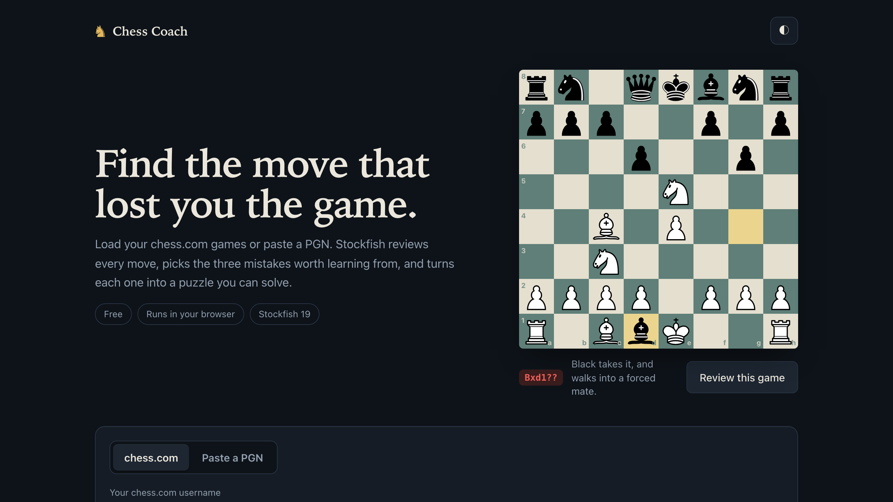
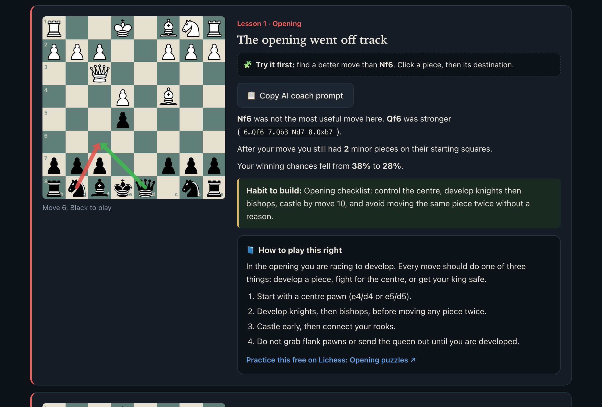
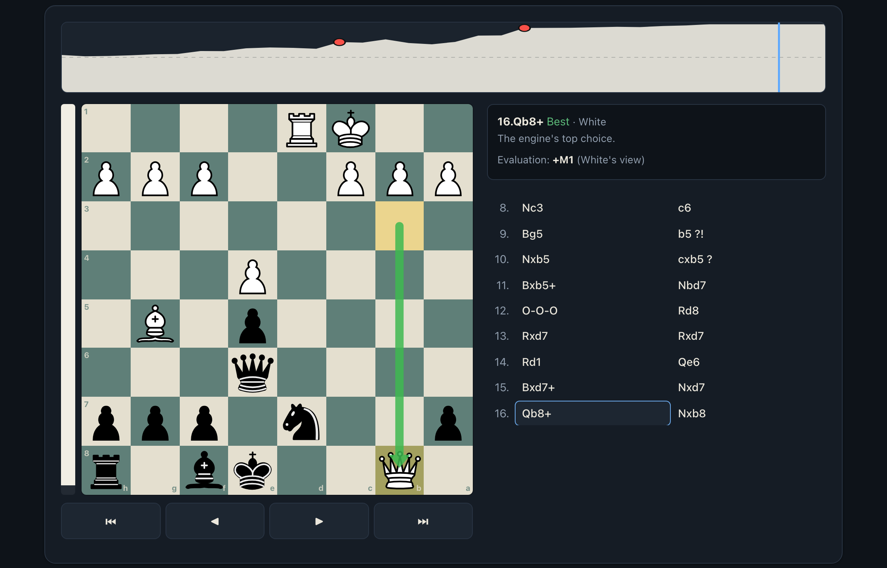
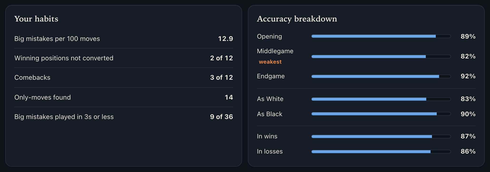

# Chess Coach

**Free chess game review that teaches.** Load your chess.com games, and Stockfish finds the three mistakes that cost you the most, explains each one, and turns it into a puzzle you solve on the board. A progress dashboard then shows which habits keep costing you games.

**Live demo: https://chessido.netlify.app** (no sign-up, nothing to install)



Everything runs in your browser. Stockfish 19 is compiled to WebAssembly and runs in Web Workers, so there is no server, no account, no API key and no cost. Your games and stats never leave your device.

## What it does

- **Loads your games** from a chess.com username (last 12/25/50/100, filter by rapid, blitz, bullet or daily) or from a pasted PGN.
- **Reviews every move** with Stockfish and rates it: best, excellent, good, inaccuracy, mistake, blunder.
- **Picks the 3 lessons that matter** and labels the pattern behind each: hung piece, allowed fork, missed mate, king stuck in the centre, and so on.
- **Makes each lesson a puzzle.** The board is set up before your mistake and you try to find a better move first. Wrong answers say so; "Show answer" reveals the engine line.
- **Tracks progress** across games: accuracy trend, results, recurring mistake types, weakest game phase and opening, and your best game of the day.
- **Saves analysis locally**, so reopening a reviewed game is instant. Batch mode analyses your whole list in the background while you keep browsing.

| Key lessons with a "find the better move" drill | Full game viewer with eval graph |
|---|---|
|  |  |

After a batch review, the progress dashboard shows your habits and where your accuracy drops (this one is from a real 12-game chess.com history):



## How it works

| Piece | What it does |
|---|---|
| **Engine pool** | `hardwareConcurrency - 1` Stockfish workers (max 6 on desktop, 2 on mobile) analyse positions in parallel. |
| **Priority queue** | Two queues, high and low. The game you open jumps ahead of the background batch. |
| **Memoisation** | Results are cached by FEN, so repeated positions (and re-opened games) cost nothing. |
| **Move rating** | Evaluations are turned into win probability with the Lichess formula `50 + 50 * (2 / (1 + e^(-0.00368208 * cp)) - 1)`. A move's rating comes from how much win probability it gave up, and accuracy uses the Lichess accuracy curve. |
| **Lesson classifier** | A rule-based engine (no LLM) inspects the best line and the punishing line: material swing, forks, mate threats, king safety, game phase. It names the pattern, explains it and picks a habit to practise. |
| **Storage** | Games, stats and analysis are in `localStorage`. The analysis cache keeps up to 120 games and evicts oldest-first, including when the browser quota runs out. |
| **Board** | A small SVG and DOM board. Pieces slide between squares using the Web Animations API; arrows show your move against the engine's. |

Stockfish is the lite single-threaded build, so the page does not need special headers (`SharedArrayBuffer`) and works on any static host.

## Run it locally

No build step. It must be served over HTTP, because Web Workers do not load from `file://`.

```bash
git clone https://github.com/Idosiloni/chess-coach.git
cd chess-coach
python3 -m http.server 8765
```

Open http://localhost:8765. To deploy, put the folder on any static host (Netlify, GitHub Pages, Cloudflare Pages).

## Privacy

There is no backend and no analytics. The only network calls are to the public chess.com API for the username you enter. Games, analysis and progress stay in your browser's `localStorage`; "Clear saved progress" wipes them.

## Honest limits

- The strength estimate is a rough heuristic from average centipawn loss. It is shown only when you have at least 15 moves in a game, rounded to the nearest 50, and it is not a rating.
- Analysis depth is a trade-off. Depth 16 (the default) is good for learning; depth 12 is faster but noisier.
- Lesson explanations are pattern rules, so they are right more often than not but can miss subtle positional ideas. The "Copy AI coach prompt" button packages the engine facts so you can ask a chatbot for a deeper explanation.
- chess.com only; Lichess support is on the roadmap.

## Project layout

```
index.html         app markup and script (UI, analysis, lesson engine, progress tracker)
css/style.css      design tokens and styles, light and dark
engine/            Stockfish 19 lite single-thread WASM (GPLv3)
lib/               chess.js 0.10.3 (move generation and PGN parsing)
pieces/            cburnett piece set
docs/              README screenshots and the source for the link-preview image
scripts/           screenshots.mjs regenerates docs/*.png (headless Chrome, no dependencies)
```

## Roadmap

- Lichess usernames
- Practice mode built from your own saved blunders
- Split `index.html` into ES modules and add unit tests for the lesson classifier
- Installable offline (PWA)
- Analyse straight from a chess.com game link

## Credits and license

Chess Coach is licensed under [GPL-3.0](LICENSE), matching the bundled Stockfish.

[Stockfish](https://github.com/official-stockfish/Stockfish) (GPLv3) via [stockfish.js](https://github.com/nmrugg/stockfish.js) by nmrugg · [chess.js](https://github.com/jhlywa/chess.js) (BSD) · cburnett piece set by Colin M.L. Burnett (GPLv2+) via [Lichess](https://lichess.org). Win-probability and accuracy formulas follow Lichess's published approach. Not affiliated with chess.com. Example game in the screenshots: Morphy vs. the Duke of Brunswick and Count Isouard, Paris, 1858.
